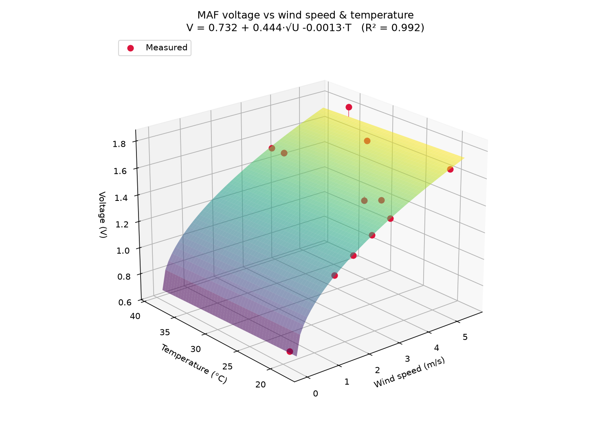
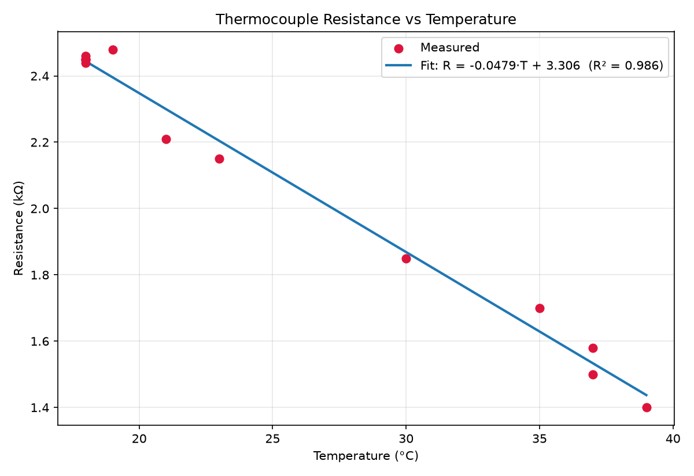

# MAF Anemometer

Characterisation of a **DENSO 197400-5111** (from a 2005-2011 Subaru Impreza) automotive mass air flow (MAF) sensor so it can be used as a low-cost anemometer (wind speed sensor).

The sensor's output voltage depends on both air speed and air temperature. This repo has the test rig, the raw measurements and the script used to fit two calibration equations from them:

1. **Output voltage as a function of wind speed and temperature**, which can be inverted to get wind speed from a voltage reading.
2. **Temperature sensor resistance as a function of air temperature**, so the sensor can supply its own temperature correction.

## Repository contents

| File | Description |
| --- | --- |
| `wind_tunnel.step` | 3D-printable duct for an axial fan, used as a small wind tunnel |
| `maf_readings.csv` | Raw calibration measurements (13 points) |
| `maf.py` | Fits the calibration equations and generates the plots |
| `maf_voltage_surface.png` | Voltage vs wind speed and temperature, with the fitted surface |
| `maf_resistance_vs_temp.png` | Resistance vs temperature, with the fitted line |

## Test setup

The data was collected with a small home-built wind tunnel:

1. **Duct:** a duct for an axial fan was 3D printed (`wind_tunnel.step`) to give a channelled, repeatable air stream.
2. **MAF sensor:** the DENSO MAF sensor was inserted into the duct so its sensing element sits in the air stream.
3. **Reference temperature:** a thermocouple was placed inside the duct to measure the actual air temperature at the sensor.
4. **Temperature control:** the air temperature was varied by blowing air from a temperature-controlled heat gun into the fan intake, so heated air was drawn through the duct and over the sensor.
5. **Reference wind speed:** the air speed was measured at the duct exit with a hand-held anemometer.

For each operating point, the following were recorded:

| Column | Unit | Source |
| --- | --- | --- |
| `wind_speed` | m/s | Hand-held anemometer at the duct exit |
| `temp` | °C | Thermocouple inside the duct |
| `voltage` | V | MAF sensor output |
| `resistance` | kΩ | Resistance of the MAF sensor's temperature element |

The measurements cover about 0 to 5.5 m/s and 18 to 39 °C.

## Deriving the equations

Both equations were fitted with ordinary least squares in `maf.py` (NumPy `lstsq` / `polyfit`). The steps are below.

### 1. Voltage vs wind speed and temperature

**Step 1: Look at the raw data.** At constant temperature (the 18 °C points), the voltage rises quickly at low wind speed and then flattens out. A straight line does not describe that shape well.

**Step 2: Pick a model shape from the physics.** A MAF sensor is a hot-element sensor: it keeps a heated element above air temperature, and its output reflects how much power it takes to do that. Heat loss from a heated wire or film in a cross-flow follows **King's law**, where the heat transfer grows roughly with the square root of the air speed. That points to a √U term for wind speed. Temperature was added as a linear term, because the warmer the air, the less the element is cooled at the same speed.

**Step 3: Compare candidate models.** Several forms were fitted to the same 13 points:

| Model | R² | RMSE (V) |
| --- | --- | --- |
| Plane: V = a + b·U + c·T | 0.920 | 0.073 |
| **King's-law style: V = a + b·√U + c·T** | **0.992** | **0.024** |

A version with an extra √U·T interaction term fitted slightly better, but with only 13 points that extra parameter mostly fits noise, so the simpler model was kept.

**Step 4: Final equation.**

$$
V = 0.7325 + 0.4439\,\sqrt{U} - 0.00134\,T
$$

where V is in volts, U in m/s and T in °C (R² = 0.992).



In the plot, the red points are measurements and the thin vertical lines show the distance from each point to the fitted surface.

### 2. Resistance vs temperature

**Step 1: Look at the raw data.** The resistance falls steadily as the temperature rises (2.48 kΩ at 19 °C down to 1.40 kΩ at 39 °C) and barely depends on wind speed. That is the behaviour of an NTC thermistor, such as the intake air temperature (IAT) sensor built into many MAF sensors.

**Step 2: Fit a line.** Over this narrow 18–39 °C range, a straight line fits well (R² = 0.986). Adding a quadratic term did not meaningfully improve the fit.

**Step 3: Final equation.**

$$
R = 3.3063 - 0.04792\,T
$$

where R is in kΩ and T in °C (RMSE ≈ 0.047 kΩ).



## Using the sensor as an anemometer

To measure wind speed, the two equations are used in reverse:

**1. Get the air temperature from the resistance:**

$$
T = \frac{3.3063 - R}{0.04792}
$$

**2. Get the wind speed from the voltage and temperature:**

$$
U = \left(\frac{V - 0.7325 + 0.00134\,T}{0.4439}\right)^2
$$

If the term inside the brackets comes out negative (still air plus noise), clamp it to zero.

Applied back to the calibration data, these equations recover wind speed with an RMSE of about 0.24 m/s and temperature with an RMSE of about 1 °C. The largest wind speed error is at the fastest point (5.5 m/s at 35 °C), which the equations read as about 6.3 m/s. This is where the curve is flattest, so a small voltage error has the biggest effect.

Python example:

```python
import numpy as np

def maf_temperature(resistance_kohm):
    return (3.3063 - resistance_kohm) / 0.04792

def maf_wind_speed(voltage, temp_c):
    x = (voltage - 0.7325 + 0.00134 * temp_c) / 0.4439
    return np.clip(x, 0, None) ** 2
```

## Reproducing the fit

```bash
pip install numpy pandas matplotlib
python maf.py maf_readings.csv
```

The script prints nothing; it opens both figures and saves them as `maf_voltage_surface.png` and `maf_resistance_vs_temp.png`. The coefficients are shown in the plot titles and legend.

## Limitations

More points spread across the full speed and temperature range, especially warm air at low and high speeds, would improve both equations.
